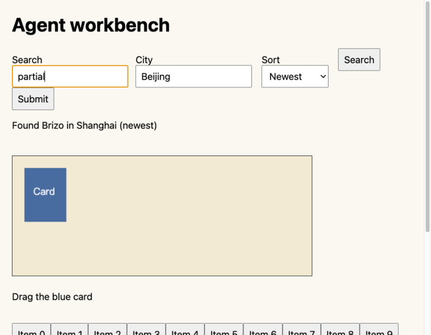
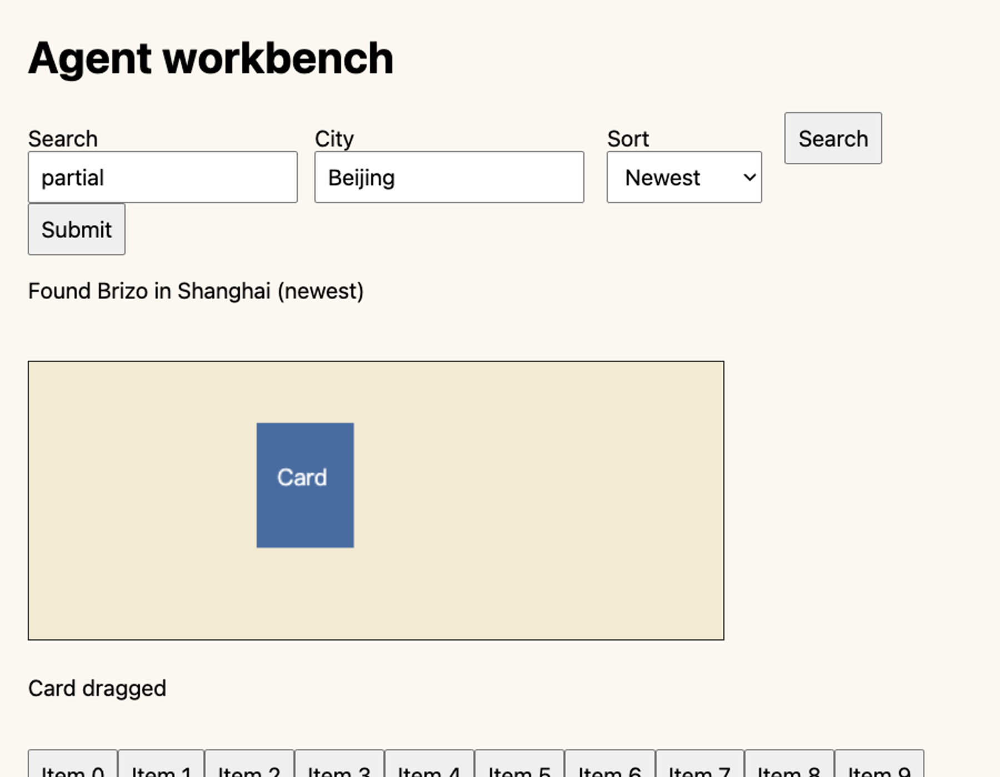

# Agent 接口验收

2026 年 10 月 25 日，0.5.0 在独立的隐藏 Electron 实例中完成 13 个真实 Chromium 场景，全部通过。项目检查另有 118 项测试通过，公开文件边界、语法与 npm 包检查通过。原始统计和逐项场景见 [validation.json](./agent-evidence/validation.json)。

测试环境为 macOS、Electron 44.2.0、Chromium 152.0.7977.76。测试使用公开的固定页面样本，由隔离会话在内存中响应合成域名，不访问真实账号。宿主启用 offscreen 渲染；窗口始终隐藏，前台激活 API 调用次数为 0。

本次覆盖了创建即返回观察、截图后继续动作、语义目标批处理、异步结果等待、观察筛选与变化、等待超时后保留 Agent 控制权、过期引用拦截、批处理失败后的部分结果、整批参数预检、Canvas 拖拽和未经授权的提交拦截。拖拽在 125% 网页缩放下执行，前后截图确认卡牌位置发生变化：

后续接入桌面宿主时，补充了旧宿主兼容测试，项目测试增至 119 项。该测试确认旧版截图后会刷新引用，语义目标和批处理在客户端明确报错，不会发出旧宿主无法识别的动作。桌面集成另用当前构建产物和嵌入 Runtime 验证了 14 个隐藏场景，其中新增场景确认原有过程记录与追问继续执行仍可用；此项集成记录不作为 Ego 对比数据。




同一测试页包含表单、Canvas 和 60 个普通按钮，观察输出大小如下：

| 输出方式 | JSON 字节数 |
| --- | ---: |
| 完整观察 | 40,763 |
| 默认精简观察 | 9,331 |
| 只保留搜索按钮，不返回页面正文 | 483 |

精简观察比完整观察少约 77.1%。这是同一版本中两种输出方式的比较，字节数也不等于模型 token 数。三步表单操作通过一次 `batch` 调用完成，运行时逐步观察并重新定位目标。

整个验收流程耗时 1,845 毫秒，包含 24 次客户端调用及故意触发的失败场景。这个单次记录用于复现验收，不代表网站任务的平均耗时。

Ego 对比目前未完成。独立隐藏实例提示需要首次设置，用户要求保持后台，因此没有继续前台设置，也没有拿日常浏览器资料替代测试环境。当前记录不支持“所有指标优于 Ego”的结论。后续对比需在两端使用同样的页面内容、视口、任务目标与完成条件，分别记录成功率、调用次数、输出字节、耗时分布及人工介入次数。

在源码仓库中复现：

```sh
npm ci
npm run check
npm install --no-save --package-lock=false electron@44.2.0
npm run verify:agent -- --output /绝对路径/agent-validation.json
```

也可通过 `--electron /绝对路径/Electron可执行文件` 使用已有运行时。GitHub CI 运行跨平台项目检查，并在 macOS 运行隐藏浏览器验收。浏览器宿主同步嵌入新版 Runtime 后才具备这些能力。
