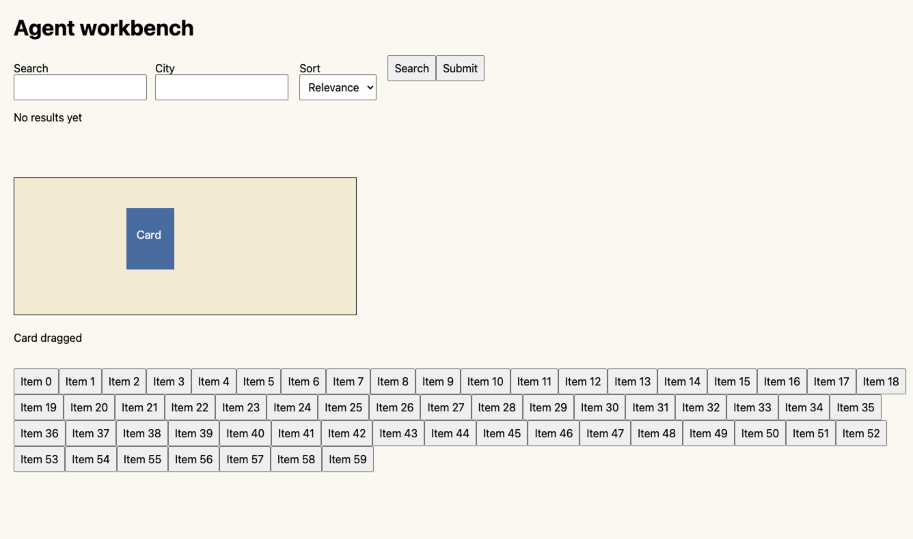
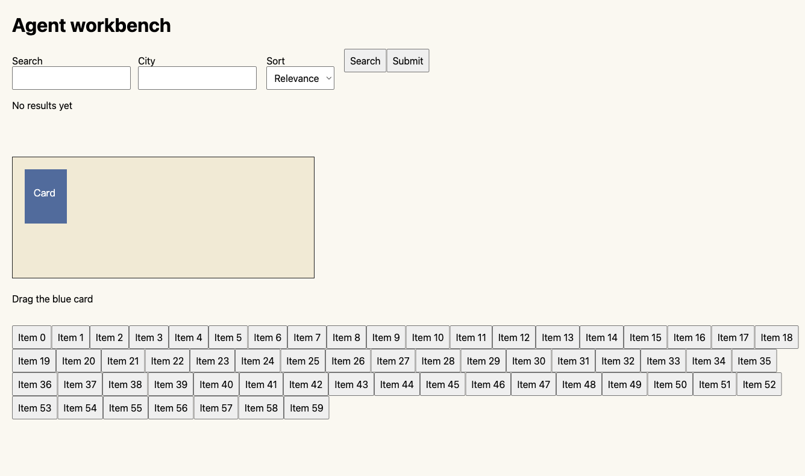
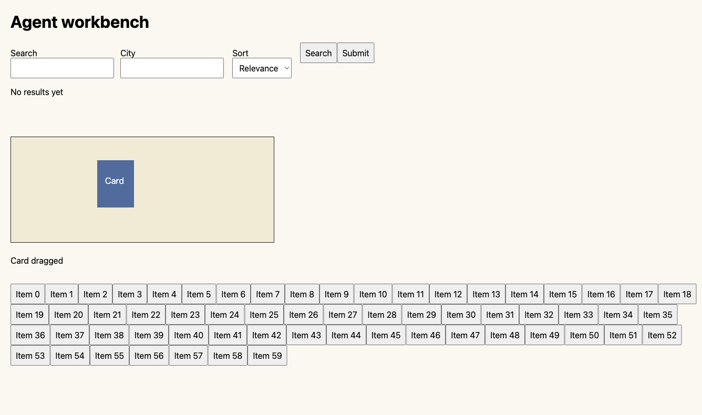

# Brizo 与 Ego 后台实测 · 2026-10-25

本页保留提交 `2feb1f1` 的固定页面测量。后续真实网站任务与代码修复见[三站实测](./real-sites-comparison-2026-10-25.md)。

同一固定页面、四类任务、每类各五次配对测试，两边均为 20/20 成功。Brizo 在表单、异步等待和 Canvas 任务中耗时更低，纯页面观察基本持平。最终语义观察正文少约 10%–13%。这些结果适用于本次页面和运行版本，尚不足以判断所有网站上的整体表现。

| 任务 | Brizo 中位耗时 | Ego 中位耗时 | 本次差异 | 最终观察字节 Brizo / Ego | 内部 API 调用 Brizo / Ego |
| --- | ---: | ---: | --- | ---: | ---: |
| 完整页面观察 | 5.03 ms | 5.01 ms | 基本持平 | 2,748 / 3,069 | 1 / 1 |
| 填两项、选排序、搜索并等结果 | 645.02 ms | 1,390.90 ms | Brizo 低 53.6% | 2,791 / 3,125 | 1 / 6 |
| 点击搜索并等异步结果 | 178.13 ms | 240.08 ms | Brizo 低 25.8% | 2,814 / 3,131 | 1 / 3 |
| 截图、拖动、等状态、截图与观察 | 125.86 ms | 160.19 ms | Brizo 低 21.4% | 2,737 / 3,129 | 3 / 8 |

五次样本的耗时范围分别为：观察 Brizo 2.26–5.32 ms、Ego 4.38–5.75 ms；表单 628.82–651.51 / 1,361.80–1,422.32 ms；等待 177.51–181.64 / 238.23–245.98 ms；Canvas 120.92–126.85 / 149.58–162.36 ms。全部 40 条样本、源码 SHA-256、固定页面哈希和截图实际尺寸保存在 [ego-release.json](./agent-evidence/ego-release.json)。

## 测试条件

Ego 复用现有的 Agent 独立 Space 50，名称为 `Brizo agent benchmark October 25`，最终采样使用其中新建的测试页 p4。全程保持后台，普通标签和日常资料未参与测试。此前需要首次设置的是另建资料目录的独立进程；现有 Space 可直接用于后台测试。

Ego 实际运行版本为 0.6.0.20，页面 UA 为 Chrome/154，使用已安装的 ego-browser Skill 2.1.0 API。CLI 显示有新版可用，本次保留运行版本。Brizo 使用 Electron 44.2.0、Chromium 152.0.7977.76。两边 Chromium 版本不同，原生表单字体也有小幅差异。

两边使用相同 HTML，包含两个输入框、排序框、搜索和提交按钮、Canvas 与 60 个普通按钮；搜索结果固定在 80 ms 后出现。Ego 通过本机 HTTP 读取页面，Brizo 在隔离会话中响应合成域名。页面加载和初始观察在计时前完成。脚本先读取 Ego 实际视口，再创建同尺寸的 Brizo 页面；最终视口与所有 PNG 均为 1336×790 CSS 像素，DPR 为 2。截图尺寸不一致会中止采样。

每次任务前重置页面，奇偶轮交替先测 Brizo 或 Ego。计时包含运行时动作、等待、截图和最终语义观察，排除进程启动、CLI 启动、导航及初始观察。两边都在一个外层脚本中执行；表中的调用数是脚本内部 API 次数，不能折算为大模型工具轮数。

字节数仅计算最终语义观察正文的 UTF-8 长度：Brizo 为文本控件列表加观察元数据的 JSON，Ego 为 snapshot 文本。它不含图片、外围动作回执、内部 IPC，也不是 token 或模型费用。两边正文均保留完整测试页和全部控件；结构和语义信息并非逐字段相同。

## 本轮修改与 Agent 使用体验

Brizo 增加 `format:"text"`，把控件按行返回，保留引用、名称、当前值与输入限制。创建会话时指定后，后续观察沿用该格式；需要对象数组时仍可选 JSON。与修改前同页面的 9,663 字节 JSON 观察相比，本次文本观察为 2,748 字节，减少约 71.6%。旧数据见 [ego-baseline.json](./agent-evidence/ego-baseline.json)。

截图默认使用 CSS 像素，仍可选择设备分辨率；这减少了高 DPR 下的图片体积，并让图片坐标和动作坐标直接对应。拖拽默认从十二段改为两段，需要连续轨迹的应用可显式指定 1–60 段。诊断时，十二段拖动单项约耗时 221 ms，是原 Canvas 路径的主要开销。

页面观察在一次页面执行中同时检查登录要求。SDK 复用已验证的进程连接信息，继续逐次读取会话凭证；连接失败会清除缓存并返回错误，动作不会自动重放。新增测试验证了凭证撤销、传输错误和后续显式重连。

对 Agent 而言，Brizo 的批处理、动作后自动观察和条件等待能缩短固定步骤的编写与调用。Ego 的现有 Space 则直接解决了后台实例准备问题。本次尚未测长任务、多站点登录、复杂拖拽、内存占用或模型自主完成率；纯观察约 5 ms 的差异也没有实际优势。后续改进应优先看更长页面的观察信息质量及真实多站点任务，避免围绕毫秒波动继续微调。

## 截图证据与采样审计

| | 拖动前 | 拖动后 |
| --- | --- | --- |
| Brizo |  |  |
| Ego |  |  |

优化过程中的早期 Canvas 样本截图大小不同；另有长时间复用同一 Ego 页面后观察耗时升高的记录。两类记录均未进入上方结论。预归档检查还发现视口与预设值相差 12 像素，随后改为自动读取视口并重新采样。保留的[试验审计](./agent-evidence/benchmark-run-audit.json)说明各轮排除原因；最终表只取尺寸匹配的一轮五次配对样本，没有从多轮中挑选最快值。

功能验收另有 122 项项目测试、15 个隐藏 Chromium 场景通过。桌面集成使用当前生产构建和嵌入 Runtime，16 个隐藏场景通过，包含原有过程记录与追问继续执行；前台激活 API 调用为 0。详见[验收记录](./agent-validation.md)。

## 复现

先准备属于当前任务的 Ego Space 和页面，保持后台。不要把日常标签 ID 传给脚本。脚本会导航和反复重置指定页面，结束后由调用方按 Ego Skill 完成 Space 清理。

```sh
npm ci
node scripts/benchmark-agent.mjs --ego-space YOUR_SPACE_ID --ego-page YOUR_PAGE_LABEL \
  --samples 5 --phase matched --electron /absolute/path/to/Electron \
  --output /absolute/path/to/ego-comparison.json
```

固定页面为 `scripts/fixtures/agent-workbench.html`，脚本仅增加等待场景的预填初始化。`--electron` 可省略并使用本机安装的 Electron。该对比依赖可用的 Ego 本地运行时，因此不在通用 CI 中强制执行。
